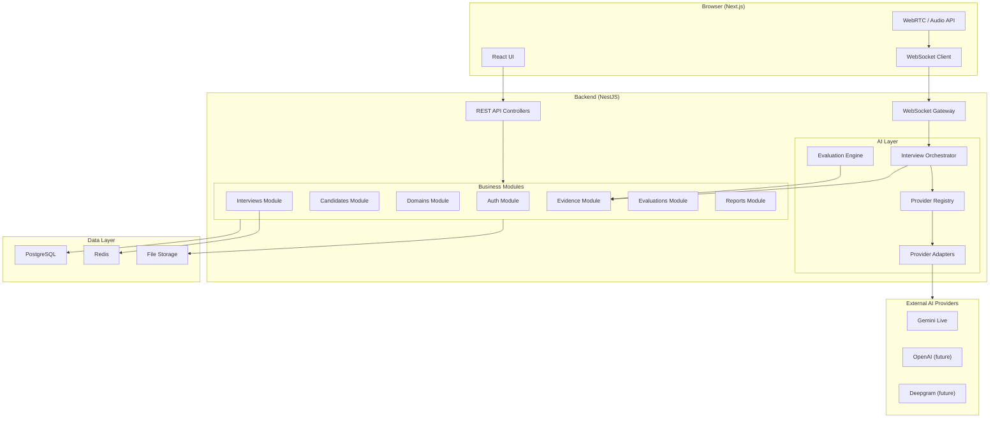
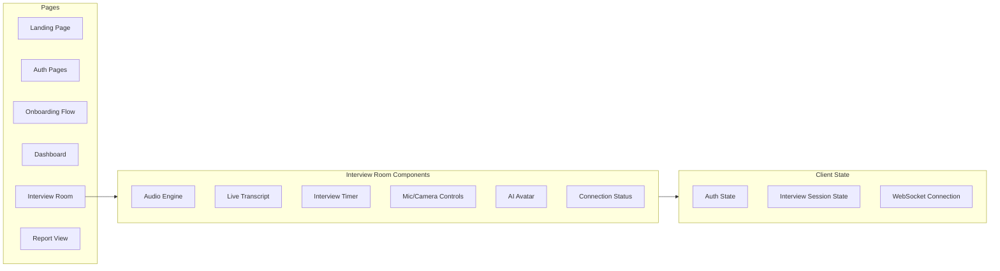
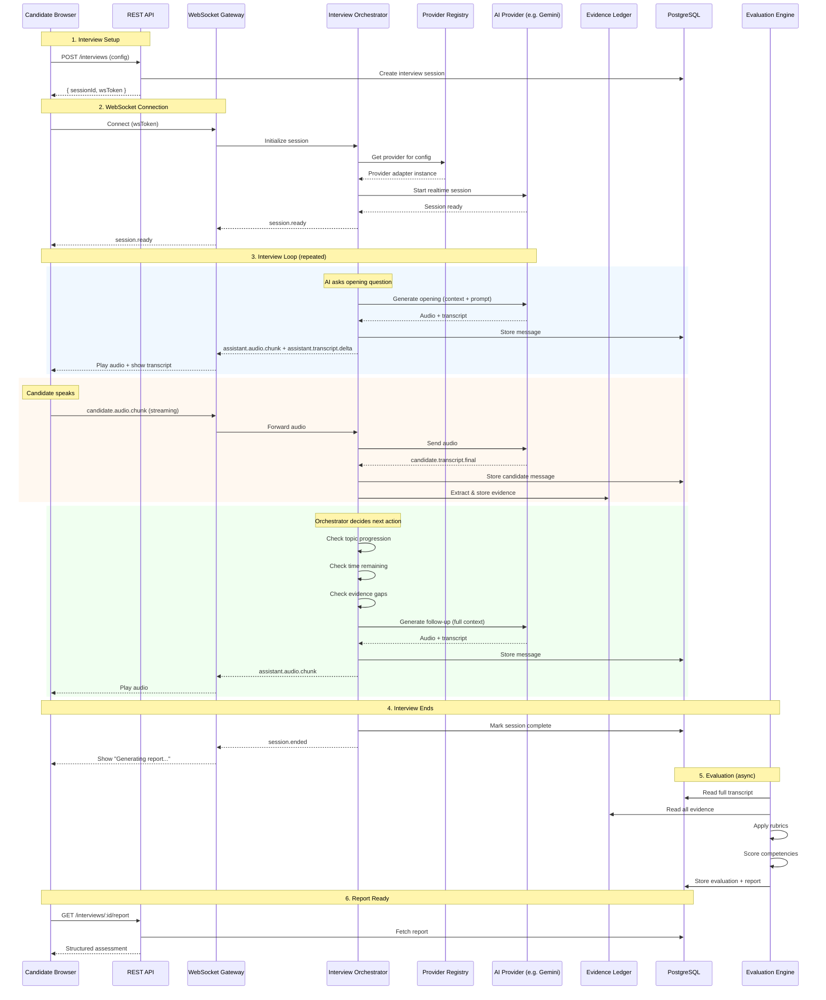
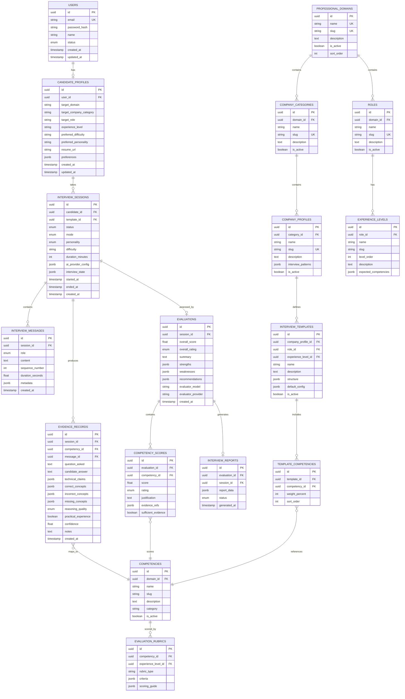
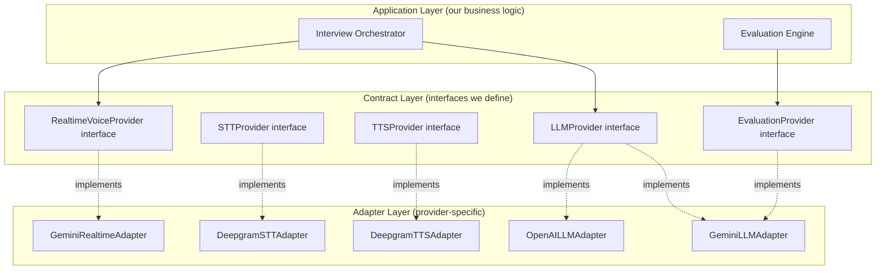
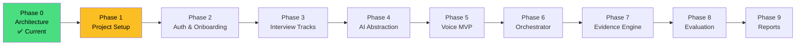

# Phase 0: Product & Technical Foundation — AI Interview Platform

> [!IMPORTANT]
> This document is the architectural blueprint for the entire project. Read it carefully, ask questions, and approve before we write any code.

---

## Table of Contents

1. [Product Summary](#1-product-summary)
2. [MVP Scope](#2-mvp-scope)
3. [System Architecture](#3-system-architecture)
4. [Component Diagram](#4-component-diagram)
5. [Data Flow: End-to-End Interview](#5-data-flow-end-to-end-interview)
6. [Technology Stack — With Justifications](#6-technology-stack--with-justifications)
7. [Database Design (ER Diagram & Key Entities)](#7-database-design)
8. [AI Provider Architecture](#8-ai-provider-architecture)
9. [API Architecture](#9-api-architecture)
10. [Security & Privacy Plan](#10-security--privacy-plan)
11. [Risk Analysis](#11-risk-analysis)
12. [Cost Analysis](#12-cost-analysis)
13. [Development Roadmap](#13-development-roadmap)
14. [Acceptance Criteria for Phase 0](#14-acceptance-criteria)

---

## 1. Product Summary

### What we're building
An AI-powered technical interview platform where software engineers and SAP consultants practice realistic voice interviews with an AI interviewer that behaves like an experienced human.

### What makes this different from a chatbot
Most "AI interview" tools read questions from a list. Ours will:
- **Probe** — ask follow-up questions based on what the candidate actually said
- **Adapt** — increase or decrease difficulty in real time
- **Collect evidence** — track what the candidate demonstrated across many answers
- **Evaluate independently** — a separate evaluation engine reads the transcript and evidence, not the interviewer's opinion

### Who it's for (MVP)
Individual candidates preparing for:
1. **SDE interviews** — FAANG-style, product companies, service companies
2. **SAP interviews** — SAP product companies, consulting partners, enterprise customers

### Business model
B2C candidate-first. Free tier to start. Enterprise features designed into the architecture but not built yet.

---

## 2. MVP Scope

### What's IN the MVP
| Feature | Description |
|---------|-------------|
| Auth | Email/password registration & login |
| Onboarding | Domain → Company category → Role → Experience → Difficulty → Duration → Personality |
| Interview tracks | SDE (3 company categories, 5 experience levels) |
| Voice interview | Browser mic → AI voice response → live transcript |
| AI interviewer | Context-aware follow-ups, adaptive difficulty, topic progression |
| Evidence ledger | Per-competency evidence collection during interview |
| Evaluation engine | Independent post-interview assessment with rubrics |
| Interview report | Competency scores, strengths, gaps, recommendations |
| Candidate dashboard | Interview history, reports |

### What's OUT of MVP (but architected for)
- SAP specializations (Phase 12)
- Coding environment with Monaco Editor (Phase 10)
- Video feed (Phase 11)
- Resume upload personalization
- Multiple AI providers (ship with one, architecture supports swap)
- Enterprise/org accounts
- Payment/subscriptions
- Custom rubrics

### The Smallest Useful Product
A candidate can:
1. Sign up
2. Select "SDE → FAANG-style → Google-style → SDE II → Medium → 15 min → Professional"
3. Click "Start Interview"
4. Have a 15-minute voice conversation with an AI that asks real technical questions and follows up intelligently
5. Receive a structured assessment report with competency scores and feedback

If we can deliver this end-to-end, we have a product.

---

## 3. System Architecture

### Architecture Style: Modular Monolith

**Why not microservices?**
- We're one developer
- Microservices add network boundaries, deployment complexity, distributed tracing, and eventual consistency problems
- A well-structured modular monolith can be split into services later if needed
- Companies like Shopify ran monoliths at massive scale before selectively extracting services

**What "modular monolith" means:**
- One deployable backend application
- Internally organized into modules with clear boundaries
- Modules communicate through well-defined interfaces, not by reaching into each other's internals
- Database tables are "owned" by their module — other modules go through the service layer
- When a module needs to become a service, you extract it along its existing boundary

### High-Level Architecture



### Key Architectural Decisions

| Decision | Choice | Rationale |
|----------|--------|-----------|
| Architecture style | Modular monolith | Solo dev, avoid distributed system complexity |
| Frontend framework | Next.js (App Router) | SSR for SEO pages, React for interactive UI, one framework |
| Backend framework | NestJS | Module system, dependency injection, TypeScript-native, good for structured backends |
| Database | PostgreSQL | Relational integrity for interview data, JSONB for flexible metadata, pgvector for future semantic features |
| Realtime transport | WebSocket | Bidirectional audio streaming, interview state updates |
| AI abstraction | Adapter pattern + Provider Registry | Swap providers without rewriting business logic |
| Interview intelligence | Owned by our Orchestrator, not by the AI provider | Provider gives capabilities; we own the logic |
| Evaluation | Separate engine, reads transcript + evidence | Prevents interviewer bias, enables re-evaluation |

---

## 4. Component Diagram

### Frontend Components



### Backend Module Responsibilities

| Module | Responsibility |
|--------|---------------|
| **Auth** | Registration, login, JWT tokens, session management |
| **Candidates** | User profiles, preferences, interview history |
| **Domains** | Professional domains, company categories, roles, experience levels |
| **Interviews** | Interview sessions, state management, transcript storage |
| **Evidence** | Evidence ledger — per-competency evidence records |
| **Evaluations** | Post-interview assessment, rubric application, scoring |
| **Reports** | Assessment reports, recommendations, progress tracking |
| **AI Layer** | Provider contracts, adapters, registry, orchestrator |

---

## 5. Data Flow: End-to-End Interview

This is the most important flow in the entire application. Let me walk through what happens from the moment a candidate clicks "Start Interview" to when they receive their report.



### What the Orchestrator owns (not the AI provider):

1. **Interview state** — which phase we're in (intro, technical, behavioral, wrap-up)
2. **Topic progression** — which competencies have been covered, which need attention
3. **Evidence ledger** — what the candidate has demonstrated so far
4. **Difficulty level** — current difficulty and when to adjust
5. **Time management** — how much time remains, when to transition
6. **Interview policy** — practice vs assessment mode rules
7. **Transcript** — canonical record of the conversation
8. **Context window** — what context to send to the AI provider for the next turn

The AI provider receives a carefully constructed prompt with context and returns a response. It does not independently decide to change topics or end the interview.

---

## 6. Technology Stack — With Justifications

### Frontend

| Technology | Why |
|-----------|-----|
| **Next.js 15 (App Router)** | Server components for landing/dashboard pages (fast initial load, SEO). Client components for the interactive interview room. One framework handles both. |
| **React 19** | Component model, hooks, excellent ecosystem. You likely already know React basics. |
| **TypeScript** | Catches bugs at compile time. Essential for a complex app with many data shapes. |
| **Tailwind CSS 4** | Utility-first CSS — fast to build UIs, no naming debates, small bundle with purging. |
| **shadcn/ui** | Not a dependency — copies accessible, well-built components into your project. You own the code. Built on Radix UI primitives (proper ARIA, keyboard nav). |
| **Web Audio API** | Browser-native audio capture. No extra library needed for mic access. |

### Backend

| Technology | Why |
|-----------|-----|
| **NestJS** | Opinionated module structure, built-in dependency injection, decorators for routes/guards/pipes, WebSocket gateway support. Teaches you enterprise patterns while being productive. |
| **TypeScript** | Shared types between frontend and backend. Same language everywhere. |
| **TypeORM** | TypeScript-native ORM with migration support. Decorators match NestJS style. Alternatives: Prisma (better DX but less control), Drizzle (newer). TypeORM is battle-tested for this use case. |
| **Passport.js** | Authentication strategies. Works well with NestJS guards. |
| **Socket.IO** | WebSocket library with fallback, rooms, namespaces, reconnection. More robust than raw `ws` for our bidirectional audio streaming needs. |

### Database & Infrastructure

| Technology | Why |
|-----------|-----|
| **PostgreSQL 16** | Relational integrity for interviews, users, evaluations. JSONB for flexible AI metadata. pgvector extension for future semantic search. Industry standard. Free. |
| **Redis** | Interview session cache (fast reads during active interviews), BullMQ job queue for async evaluation. |
| **BullMQ** | Queue for post-interview evaluation jobs. When an interview ends, we queue the evaluation — the candidate doesn't wait for it synchronously. |
| **MinIO** | S3-compatible object storage that runs locally. For resumes, recordings. Swap to AWS S3/GCS in production. |

### AI Providers (Initial)

| Provider | Role | Why |
|----------|------|-----|
| **Google Gemini** | Primary LLM + potential realtime voice | Free tier available, multimodal, strong reasoning. Gemini 2.0 Flash has native audio capabilities. |
| **Deepgram** | Alternative STT/TTS | Excellent streaming STT (Nova-2), low-latency TTS (Aura). \$200 free credit for new accounts. |
| **OpenAI** | Alternative LLM | GPT-4o with realtime API. Pay-per-use but strong capability. Future option. |

### Development Tools

| Tool | Why |
|------|-----|
| **pnpm** | Fast, disk-efficient package manager. Excellent monorepo/workspace support. |
| **Turborepo** | Monorepo build orchestration — parallel builds, caching. Lightweight. |
| **ESLint + Prettier** | Code quality and consistent formatting |
| **Vitest** | Fast TypeScript-native test runner. Compatible with Jest API. |
| **Swagger/OpenAPI** | Auto-generated API docs from NestJS decorators |

> [!NOTE]
> **Why pnpm + Turborepo instead of Nx?**
> Nx is powerful but heavy. For a solo dev, pnpm workspaces + Turborepo gives us monorepo benefits (shared types, parallel builds) without the learning curve and configuration overhead of Nx. If we need Nx-level features later, migration is straightforward.

---

## 7. Database Design

### ER Diagram (Core Entities)



### Key Design Decisions

| Decision | Rationale |
|----------|-----------|
| **UUIDs as PKs** | No sequential ID guessing in URLs. Safe for multi-tenant future. |
| **Separate `users` and `candidate_profiles`** | Users table is for auth. Profile is for interview context. A user might later be an interviewer or admin. |
| **Evidence as separate records, not embedded JSON** | We need to query evidence by competency, join with messages, aggregate across interviews. Relational > JSON blob. |
| **`interview_state` as JSONB** | Active interview state (current topic index, difficulty adjustments) is ephemeral and schema-flexible. JSONB is appropriate here. |
| **`ai_provider_config` as JSONB** | Provider-specific session metadata varies by provider. JSONB avoids a column per provider. |
| **Template + competency join table** | Different templates weight competencies differently. A Google SDE II template weights System Design at 25%; a service company template might weight it at 10%. |

### Access Patterns & Indexes

| Query | Indexes Needed |
|-------|---------------|
| Login by email | `users.email` (unique) |
| Get candidate's interviews | `interview_sessions.candidate_id` |
| Get messages for a session | `interview_messages.session_id` + `sequence_number` |
| Get evidence for a session | `evidence_records.session_id` |
| Get evidence by competency | `evidence_records.competency_id` |
| List templates by domain/role | `interview_templates.company_profile_id`, `role_id` |
| Active interviews | `interview_sessions.status` (partial index WHERE status = 'active') |

---

## 8. AI Provider Architecture

### The Core Problem

If we hardcode Gemini SDK calls throughout our interview logic:

```typescript
// ❌ BAD: Business logic coupled to Gemini
async function askFollowUp(context) {
  const gemini = new GoogleGenerativeAI(process.env.GEMINI_KEY);
  const model = gemini.getGenerativeModel({ model: 'gemini-2.0-flash' });
  const result = await model.generateContent(buildPrompt(context));
  // ...
}
```

Then switching to OpenAI means finding and rewriting every place we call Gemini. This is what the **Adapter Pattern** and **Dependency Inversion** prevent.

### The Solution: Three Layers



**The Orchestrator depends on interfaces, not implementations.** At startup, the Provider Registry reads configuration and injects the correct adapter. The Orchestrator never imports `@google/generative-ai` or `openai` directly.

### Provider Capability Matrix

Not every provider supports everything. The registry must know this:

| Capability | Gemini | OpenAI | Deepgram |
|-----------|--------|--------|----------|
| Streaming LLM | ✅ | ✅ | ❌ (BYO-LLM) |
| Native realtime voice | ✅ (Live API) | ✅ (Realtime API) | ✅ (Voice Agent) |
| Standalone STT | ✅ | ✅ (Whisper) | ✅ (Nova-2) |
| Standalone TTS | ✅ | ✅ | ✅ (Aura) |
| Function calling | ✅ | ✅ | Via LLM |
| Interruption handling | ✅ | ✅ | ✅ |
| Free tier | ✅ (generous) | ❌ (pay-per-use) | ✅ (\$200 credit) |

### Canonical Event Protocol

All providers normalize their events into our format. The frontend never knows which provider is running:

```
Provider SDK events → Adapter → Canonical ConversationEvent → WebSocket → Frontend
```

This means:
- Gemini's `responseModalities` events get mapped to `assistant.audio.chunk` + `assistant.transcript.delta`
- Deepgram's `Results` events get mapped to `candidate.transcript.final`
- OpenAI's `response.audio.delta` gets mapped to `assistant.audio.chunk`

### Initial Implementation: Architecture A (Native Realtime)

For the MVP, we'll use **Gemini Live API** as a native speech-to-speech provider:

```
Candidate mic → WebSocket → Backend → Gemini Live API → Audio response → WebSocket → Candidate speaker
```

**Why start here:**
- Simplest integration (one provider handles STT + LLM + TTS)
- Gemini has a generous free tier
- Lower latency than cascaded pipeline
- We can add the cascaded pipeline (Architecture B) later as an alternative

**The architectural abstraction still applies.** Even though Gemini Live handles everything internally, our Orchestrator still:
- Owns the interview state
- Decides what context to inject
- Manages topic progression
- Collects evidence
- Controls the session lifecycle

---

## 9. API Architecture

### REST API Endpoints (Core)

| Method | Endpoint | Purpose |
|--------|----------|---------|
| POST | `/api/auth/register` | Create account |
| POST | `/api/auth/login` | Sign in |
| POST | `/api/auth/logout` | Sign out |
| GET | `/api/auth/me` | Current user |
| GET | `/api/candidates/profile` | Get candidate profile |
| PUT | `/api/candidates/profile` | Update profile |
| POST | `/api/candidates/resume` | Upload resume |
| GET | `/api/domains` | List professional domains |
| GET | `/api/domains/:id/categories` | Company categories for domain |
| GET | `/api/domains/:id/roles` | Roles for domain |
| GET | `/api/roles/:id/experience-levels` | Experience levels for role |
| GET | `/api/interview-templates` | Available templates (filtered) |
| POST | `/api/interviews` | Create interview session |
| GET | `/api/interviews` | List candidate's interviews |
| GET | `/api/interviews/:id` | Interview details |
| GET | `/api/interviews/:id/transcript` | Full transcript |
| GET | `/api/interviews/:id/report` | Evaluation report |

### WebSocket Events

| Direction | Event | Purpose |
|-----------|-------|---------|
| Client → Server | `session.join` | Join interview room |
| Client → Server | `audio.chunk` | Stream microphone audio |
| Client → Server | `interview.pause` | Pause interview |
| Client → Server | `interview.end` | End interview |
| Server → Client | `session.ready` | Interview ready to begin |
| Server → Client | `assistant.audio.chunk` | AI voice audio |
| Server → Client | `assistant.transcript.delta` | AI speech text (incremental) |
| Server → Client | `candidate.transcript.final` | Recognized candidate speech |
| Server → Client | `interview.status` | State changes |
| Server → Client | `session.error` | Error notification |
| Server → Client | `session.ended` | Interview complete |

### API Design Principles

1. **REST for CRUD, WebSocket for realtime** — don't use WebSocket for fetching interview history
2. **Consistent error format** — `{ error: { code, message, details? } }`
3. **Pagination** — cursor-based for interview lists
4. **Versioning** — `/api/v1/` prefix when we need breaking changes
5. **OpenAPI docs** — auto-generated from NestJS decorators

---

## 10. Security & Privacy Plan

### Authentication & Authorization

| Control | Implementation |
|---------|---------------|
| Password hashing | bcrypt (cost factor 12) |
| Session tokens | JWT (short-lived access + longer refresh) |
| WebSocket auth | Token validated on connection, not per-message |
| Route protection | NestJS Guards on every protected endpoint |
| CORS | Whitelist frontend origin only |

### Input Validation

| Surface | Control |
|---------|---------|
| API inputs | class-validator decorators on DTOs |
| File uploads | Type checking (magic bytes, not just extension), size limits |
| WebSocket messages | Schema validation before processing |
| SQL | Parameterized queries via ORM (no string concatenation) |
| XSS | React's default escaping + CSP headers |

### AI-Specific Security

| Risk | Mitigation |
|------|-----------|
| API keys in browser | Never. All AI calls go through our backend. |
| Prompt injection | Candidate input is clearly delineated in prompts as "candidate said:" — not mixed with system instructions |
| Candidate code execution | Isolated sandbox (Phase 10) — never `eval()` in the backend |
| Data sent to AI providers | Audit what we send. Use synthetic data in dev. Disclose to users what data is processed by AI. |

### Privacy & Consent

| Requirement | Implementation |
|-------------|---------------|
| Recording consent | Explicit consent before interview starts |
| Data retention | Configurable retention period, ability to delete |
| Right to deletion | API to delete user data + cascaded interview data |
| AI disclosure | Clear disclosure that the interviewer is AI |
| No facial analysis | Video is optional and never analyzed for emotions/appearance |
| Transcript ownership | Candidates can export their transcripts |

> [!WARNING]
> Before sending any real personal data to AI providers in production, review each provider's data retention, training, and privacy policies. During development, use synthetic/test data only.

---

## 11. Risk Analysis

### Technical Risks

| Risk | Severity | Likelihood | Mitigation |
|------|----------|-----------|------------|
| Gemini Live API doesn't support our audio streaming pattern from browser | **High** | Medium | Build a proof-of-concept in Phase 4 before committing. Have Deepgram cascaded pipeline as fallback. |
| Voice latency too high for natural conversation | **High** | Medium | Measure latency in PoC. Consider edge deployment. Optimize context window size. |
| AI interviewer asks poor follow-up questions | **High** | Medium | Invest heavily in prompt engineering. Build test scenarios (Section 16 of your spec). Iterate. |
| Free tier API limits hit during development | **Medium** | High | Track usage. Use mocked providers for unit tests. Reserve real API calls for integration tests. |
| PostgreSQL not available locally | **Low** | Known | Install via Homebrew or use Docker. Will set up in Phase 1. |

### Product Risks

| Risk | Severity | Mitigation |
|------|----------|-----------|
| AI evaluation accuracy is poor | High | Benchmark against human ratings. Show confidence levels. Don't claim AI scores are hiring decisions. |
| Interview feels robotic | High | Personality system, natural transitions, varied question phrasing. Test with real users. |
| Users don't trust AI feedback | Medium | Show evidence citations. Transparency about AI limitations. |

### Riskiest Technical Assumption

**The single riskiest assumption is that we can build a natural-feeling voice interview through the browser using Gemini's Live API with acceptable latency.**

This must be validated in Phase 4 with a proof-of-concept before we build the full interview experience on top of it.

If Gemini Live doesn't work well for browser-based bidirectional audio, we pivot to the cascaded pipeline (Deepgram STT → Gemini LLM → Deepgram TTS), which gives us more control but adds complexity.

---

## 12. Cost Analysis

### Development Phase (Months 1-3)

| Resource | Cost (USD) | Cost (INR) | Notes |
|----------|-----------|-----------|-------|
| PostgreSQL | Free | Free | Local install via Homebrew |
| Redis | Free | Free | Local install via Homebrew |
| Node.js / pnpm / NestJS | Free | Free | Open source |
| Next.js / React / Tailwind | Free | Free | Open source |
| Gemini API | Free | Free | Free tier: 15 RPM, 1M tokens/day for Flash |
| Deepgram | ~Free | ~Free | \$200 free credit for new accounts |
| GitHub | Free | Free | Free for public/private repos |
| MinIO | Free | Free | Local object storage |
| Domain name (optional) | ~\$10-15/yr | ~₹850-1250/yr | Not needed for dev |
| **Total dev cost** | **~\$0** | **~₹0** | Until free credits exhaust |

### Production Phase (estimate per month, low usage)

| Resource | Cost (USD) | Cost (INR) | Notes |
|----------|-----------|-----------|-------|
| VPS (e.g., Railway, Render, DigitalOcean) | \$5-25/mo | ₹420-2100/mo | Depends on tier |
| PostgreSQL (managed) | \$0-15/mo | ₹0-1250/mo | Free tiers available |
| Redis (managed) | \$0-10/mo | ₹0-850/mo | Free tiers available |
| Gemini API (pay-as-you-go) | Variable | Variable | ~\$0.075/1M input tokens (Flash) |
| Object storage | \$0-5/mo | ₹0-420/mo | Minimal at low scale |
| **Estimated total** | **\$5-55/mo** | **₹420-4600/mo** | Low usage |

> [!NOTE]
> These are rough estimates. Actual AI API costs depend heavily on interview length, number of users, and model choice. We'll track usage carefully and add cost monitoring.

---

## 13. Development Roadmap



### Time Estimates (Solo Developer)

| Phase | Estimated Duration | Cumulative |
|-------|-------------------|-----------|
| Phase 0: Architecture | 1 day | Day 1 |
| Phase 1: Project Setup | 2-3 days | Day 4 |
| Phase 2: Auth & Onboarding | 4-5 days | Day 9 |
| Phase 3: Interview Tracks | 3-4 days | Day 13 |
| Phase 4: AI Abstraction + PoC | 5-7 days | Day 20 |
| Phase 5: Voice MVP | 7-10 days | Day 30 |
| Phase 6: Orchestrator | 5-7 days | Day 37 |
| Phase 7: Evidence Engine | 3-5 days | Day 42 |
| Phase 8: Evaluation | 5-7 days | Day 49 |
| Phase 9: Reports & Dashboard | 4-5 days | Day 54 |

**MVP (Phases 0-9): ~8-9 weeks of focused development**

Phases 10-15 (coding env, video, SAP, testing, deployment, enterprise) follow after the core is validated.

---

## 14. Acceptance Criteria for Phase 0

You (the developer) should be able to answer "yes" to all of these:

- [ ] I understand the overall system architecture (modular monolith, frontend/backend/DB/AI layers)
- [ ] I understand why each technology in the stack was chosen
- [ ] I understand the end-to-end data flow for an interview session
- [ ] I understand why the Interview Orchestrator and Evaluation Engine are separate
- [ ] I understand the Adapter Pattern and why AI providers are abstracted behind interfaces
- [ ] I understand the database schema and why entities are structured this way
- [ ] I understand the security model (auth, input validation, API key protection)
- [ ] I understand the risk around voice latency and the PoC plan
- [ ] I understand the cost model and free-first strategy
- [ ] I understand the build order and why we don't skip ahead

---

## What Happens Next

Once you've reviewed this document and confirmed you understand the architecture:

1. I'll walk you through **Phase 1: Project Setup** — we'll create the monorepo, install dependencies, wire up the frontend, backend, and database connection.
2. Every step will include explanations of *what* we're doing and *why*.
3. We'll verify everything works before moving on.

**Please review this document carefully. Ask me about anything that's unclear — architectural decisions, technology choices, data flow, terminology, or trade-offs. This is the foundation everything else builds on.**
